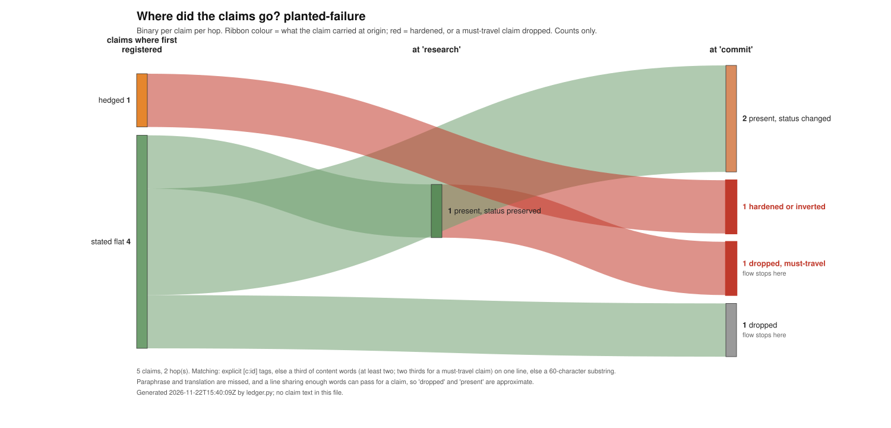

# As-Agreed

**What you agreed is what arrives.**

As-Agreed checks each step of a pipeline against what was agreed. It stops the last step if a must term changed.

Your agents report done. Today no part of your system checks that report against what was agreed. Thus the first person who finds the change is your client or your auditor.

In a multi-agent system, agents give work to agents, and at each hand-off a term you agreed can change. As-Agreed keeps the record of what was agreed, and names the hand-off where a declared term changed.

Before the last step writes its result, As-Agreed compares each declared field with the agreed record. If a field of a `MUST` or `MUST_NOT` commitment changed, As-Agreed stops that step. It tells you which field changed, and at which step.

The library runs today, on your computer. The record is a file on your disk. The test [`tests/test_no_network.py`](https://github.com/as-agreed/as-agreed/blob/main/tests/test_no_network.py) gives an error if the code imports a known network module.

After version 0.2, the As-Agreed service will keep the same record for all your runs and teams, over time.

Version 0.1.2 holds a term that a middle step lost and that no hold stopped. The hook finds the record when the agent starts in a throwaway folder. The example of the hook is in the package.

## Run the demo

```
pip install as-agreed
as-agreed demo --no-retry
```

Or run it from the source, with no package:

```
git clone https://github.com/as-agreed/as-agreed
cd as-agreed
PYTHONPATH=src python3 -m as_agreed demo --no-retry
```

You must have Python 3.9 or higher. You do not use an account. The last line of the demo shows how much time it used.

## What you see

The order sets a limit: "up to 18,400 dollars". The output for the payment system has 19,800. All the types are correct, thus the schema check passes. As-Agreed stops the step, and the code does not call the payment system. The demo above shows these lines:

```
commit#1@1    schema  amount: float ok | po: str ok | approved: bool ok   -> schema: PASS
             commitment pay-invoice      limit.amount                 WIDENED            19800 where at most 18400 USD was agreed
             claim [flat]                words only, no status        PRESERVED          "Pay the October invoice from Northwind Freight, up to 18,400 dollars, only if it mat"
gate: HOLD (1 reason(s))    outputs discarded; the payment system was never called    code 1
```

A commitment line compares one declared field. Here, the field `limit.amount` is `WIDENED`. A claim line compares the status of a claim: a hedge, a source, a date, or `not found`. It does not compare numbers. Thus the claim of the order arrives (`PRESERVED`), but its limit does not arrive (`WIDENED`).

Without `--no-retry`, the demo sends the reason back to the step one time. The next output comes from a file, not from a model, and it passes. With `--fixture dropped`, the agreed commitment `phone-check` does not arrive (`DROPPED`).

## Use it in your code

```python
import as_agreed.sdk as aa

agreed = aa.register("Pay the invoice, up to 18,400 dollars.", [{
    "commitment_id": "pay", "act": "pay the invoice", "obligor": "finance", "obligee": "vendor",
    "modality": "MUST", "limit": {"amount": {"max": 18400, "unit": "USD"}},
    "carried_by": {"limit.amount": "amount"}}])

def pay(note, *, idempotency_key):
    print("paid", note["amount"])

@aa.step("commit", agreed, commit=pay)
def prepare(text, reason=None):
    return {"amount": 19800.0}

prepare("Pay 19,800 dollars.")  # raises DriftHold: limit.amount WIDENED; pay() is not called
```

Run this code from the clone with `PYTHONPATH=src`. A commitment must have 4 fields: `act`, `obligor`, `obligee` and `modality`. The fields `condition`, `limit`, `deadline` and `acceptance_criteria` are optional. The key `carried_by` tells As-Agreed which output key holds a field. The step gets the reason in `reason`, and it runs one more time. If the next output also breaks the limit, As-Agreed stops the step. The record goes to `ledger.jsonl` in the folder where you start Python.

## Tell each step what it must have

Give a step a `binding`. Then As-Agreed checks only the commitments in `serves`:

```python
@aa.step("commit", agreed, commit=pay,
         binding={"serves": ["pay"], "kind": "takes_effect", "author": "finance"})
```

If the output does not have a key that the step must have, the field is `DROPPED`. Then a commit step stops if the commitment is `MUST` or `MUST_NOT`. A field that the step does not have to give is not `DROPPED`. If that field arrives with a different value, the change counts.

The `kind` tells what the step must have:

- `sets_terms`: a step that gives the task to a different agent. It must have all the fields, but not `obligee`.
- `takes_effect`: the step that does the work. It must have `act`, `limit`, `deadline`, `condition` and `acceptance_criteria`.
- `mentions`: a step that must have no field.

A `takes_effect` step must have `obligor` only if the `author` or the `recipient` is the `obligor`. A step with no `binding` is checked as before.

## The flag after each run

After the gate, the report and the demo show the flag. The demo with `--no-retry` shows these lines:

```
Kept as agreed: 0 of 1 binding terms, checked at delivery; 1 held (pay-invoice limit.amount WIDENED: 19800 where at most 18400 USD was agreed); 0 unchecked
0 of 1 terms kept that would have been lost
Not checked by code: 4 untyped fields of binding terms (obligor, obligee, act, modality), declared at no link
```

The first line counts the declared fields of the `MUST` and `MUST_NOT` commitments. It names each field that a hold stops, and each field that changed with no hold. The last step holds a field that an earlier step lost when no hold stopped it there, also if a later step gives it back. The next line counts the fields that arrive as agreed only because a hold made the step run again. It also gives the total of their agreed limits that have a unit such as `USD`. Each step also writes these lines to `ledger.jsonl`.

Code does not check the fields `obligor`, `obligee`, `act` and `modality` when no step declares them. The flag counts them on a line of their own. A term in words only, with no field that code can check, is on the line "Terms not restated, untyped". A `MUST` or `MUST_NOT` term on that line is held. A `SHOULD` or `MAY` term on that line is listed, and it is not held.

Set `baseline_minutes` to your time for a manual check of one run. Then the flag also shows that time when no person must look at the run. Give `baseline_minutes` to `report`, or `--baseline-minutes` to `as-agreed`.

See the band and the Board in four steps: [docs/FIRST-RUN.md](https://github.com/as-agreed/as-agreed/blob/main/docs/FIRST-RUN.md).

## Use it with Claude Code

```
/plugin marketplace add as-agreed/as-agreed
/plugin install as-agreed@as-agreed
```

The plugin adds a skill and a hook. The skill tells the agent to write the agreed record and the binding in `.as-agreed/`. The agent shows them to you. Then you manually write your name in `confirmed_by`. The hook stops a file tool that writes `confirmed_by`. The hook uses the record only after `confirmed_by` has a name.

The hook runs before each tool call. It checks only the calls in `.as-agreed/binding.json`. It stops a call if a term changed, or if a must term is missing. It also stops a file tool that changes the record after you write your name. Each checked call writes one line to `.as-agreed/hook.jsonl`, without the values of the call. The hook uses `python3`, version 3.9 or higher. It uses the `src/` folder of the plugin, and it does not use the network.

Run the hook on the example, with no agent. The package has the example:

```
pip install as-agreed
as-agreed example plugin-hold run
cd run
CLAUDE_PROJECT_DIR=$PWD as-agreed hook < events/dropped.json
```

The output stops the call, because the field `limit.amount` is `DROPPED`. The file `events/faithful.json` passes. The command `as-agreed example` writes only into a new or empty folder.

An agent can start in a throwaway folder, for example a task folder, a CI job or a cloud workdir. That folder has no `.as-agreed/`. Then set `AS_AGREED_RECORD` to the folder that holds `record.json` and `binding.json`. Or put a file `.as-agreed-record` in the start folder or a parent folder. Its one line is the path of that folder. If the folder that you name is missing or cannot be read, the hook stops the call.

## Read your traces

As-Agreed reads traces from Langfuse, LangSmith and OpenTelemetry today: `as-agreed import langfuse`, `as-agreed import langsmith` and `as-agreed import otlp`. It writes one stage folder for each trace, and the next line checks that folder:

```
as-agreed import langfuse trace.json stages --commitment order/order.md
as-agreed reconcile stages/trace-<id>
```

Give `import langfuse` a file from Langfuse: the API data, with `fields=core,basic,io`, or a file from its folder `observations_v2/`. Give `import langsmith` the runs as JSON, `.jsonl` or CSV. Give `import otlp` an OTLP JSON file. With `--commitment`, the order is your file, and the `commitments.json` file next to it is copied with it. Without `--commitment`, the order is the input at the top of the trace. It is marked `proxy: true`, because that input is not an agreement. It finds an agent only where the trace declares one, and a hand-off where that agent changes.

OpenTelemetry tools usually write no text of a step into a trace. Where a tool reads `OTEL_INSTRUMENTATION_GENAI_CAPTURE_CONTENT`, set it to `SPAN_ONLY`. A step with no text gives an empty stage, and the output line tells how many.

## The text gate

For text files, `ledger.py` checks that each claim keeps its status from one stage to the next. Put one file for each stage in a folder, in sequence. Mark each line that must arrive with `[!]` before its full stop. In the example below, a line that must arrive does not arrive (`DROPPED!`). The claim "probably allows early payment" arrives as "allows early payment" (`DANGER`). Thus the run exits with a code that is not 0, and it can stop the next step. It also writes `ledger.jsonl` and `flow.svg`, which shows each claim at each stage. In the last stage, `DANGER` marks `not found` with no date (`undated absence`) and `the only` with no dated source (`unsourced superlative`).

```
python3 ledger.py run examples/planted-failure --against-all --only hedged,not_found,sourced,dated,must --fail-on danger,dropped_must
```



## Its limits

It compares only the fields that you declare, and it does not read a field from text. A declared value in English number words counts as its number, so "three" is 3. If a value is below an agreed minimum, the result is `WIDENED`. If a key such as `done` has `false` where `true` was agreed, the result is `WEAKENED`. The hook checks only the tool calls in the binding. It does not stop a change to `.as-agreed/` that a file tool does not make. It reads `.as-agreed/` in the folder where Claude Code starts, or the folder that `AS_AGREED_RECORD` or `.as-agreed-record` names. The hook checks each call alone, so it does not hold a term that an earlier call lost. The band keeps the values of each checked call in `.as-agreed/runs/` on this machine, until you delete that folder.

## Where this goes

To use the As-Agreed service, you will change one value in your code: `destination=`. All other code stays the same.

## Tests

```
python3 -m unittest discover -s tests
```

## Licence

The code is under the Apache-2.0 licence ([LICENSE](https://github.com/as-agreed/as-agreed/blob/main/LICENSE), [NOTICE](https://github.com/as-agreed/as-agreed/blob/main/NOTICE)), copyright BizBuilder, Inc. The files in `readings/` are under CC BY 4.0. A change that you send must have a DCO sign-off (`git commit -s`).

## Help

Write to hello@bizbuilderai.com. To send the map of your pipeline without its data, read [SEND-A-MAP.md](https://github.com/as-agreed/as-agreed/blob/main/SEND-A-MAP.md).
