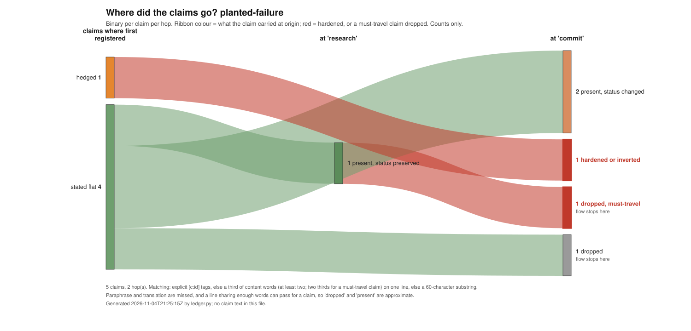

# As-Agreed

**What you agreed is what arrives.**

As-Agreed checks each step of a pipeline against what was agreed. It stops the last step if a must term changed.

Your agents report done. Today no part of your system checks that report against what was agreed. Thus the first person who finds the change is your client or your auditor.

In a multi-agent system, agents give work to agents, and at each hand-off a term you agreed can change. As-Agreed keeps the record of what was agreed, and names the hand-off where a declared term changed.

Before the last step writes its result, As-Agreed compares each declared field with the agreed record. If a field of a `MUST` or `MUST_NOT` commitment changed, As-Agreed stops that step. It tells you which field changed, and at which step.

The library runs today, on your computer. The record is a file on your disk. The test [`tests/test_no_network.py`](https://github.com/as-agreed/as-agreed/blob/main/tests/test_no_network.py) gives an error if the code imports a known network module.

After version 0.2, the As-Agreed service will keep the same record for all your runs and teams, over time.

## Run the demo

```
pip install as-agreed
as-agreed demo --no-retry
```

Or run it from the source, with no package:

```
git clone https://github.com/as-agreed/as-agreed
cd as-agreed
PYTHONPATH=src python3 -m as_agreed demo --no-retry
```

You must have Python 3.9 or higher. You do not use an account. The last line of the demo shows how much time it used.

## What you see

The order sets a limit: "up to 18,400 dollars". The output for the payment system has 19,800. All the types are correct, thus the schema check passes. As-Agreed stops the step, and the code does not call the payment system. The demo above shows these lines:

```
commit#1@1    schema  amount: float ok | po: str ok | approved: bool ok   -> schema: PASS
             commitment pay-invoice      limit.amount                 WIDENED            19800 where at most 18400 USD was agreed
             claim [flat]                words only, no status        PRESERVED          "Pay the October invoice from Northwind Freight, up to 18,400 dollars, only if it mat"
gate: HOLD (1 reason(s))    outputs discarded; the payment system was never called    code 1
```

A commitment line compares one declared field. Here, the field `limit.amount` is `WIDENED`. A claim line compares the status of a claim: a hedge, a source, a date, or `not found`. It does not compare numbers. Thus the claim of the order arrives (`PRESERVED`), but its limit does not arrive (`WIDENED`).

Without `--no-retry`, the demo sends the reason back to the step one time. The next output comes from a file, not from a model, and it passes. With `--fixture dropped`, the agreed commitment `phone-check` does not arrive (`DROPPED`).

## Use it in your code

```python
import as_agreed.sdk as aa

agreed = aa.register("Pay the invoice, up to 18,400 dollars.", [{
    "commitment_id": "pay", "act": "pay the invoice", "obligor": "finance", "obligee": "vendor",
    "modality": "MUST", "limit": {"amount": {"max": 18400, "unit": "USD"}},
    "carried_by": {"limit.amount": "amount"}}])

def pay(note, *, idempotency_key):
    print("paid", note["amount"])

@aa.step("commit", agreed, commit=pay)
def prepare(text, reason=None):
    return {"amount": 19800.0}

prepare("Pay 19,800 dollars.")  # raises DriftHold: limit.amount WIDENED; pay() is not called
```

Run this code from the clone with `PYTHONPATH=src`. A commitment must have 4 fields: `act`, `obligor`, `obligee` and `modality`. The fields `condition`, `limit`, `deadline` and `acceptance_criteria` are optional. The key `carried_by` tells As-Agreed which output key holds a field. The step gets the reason in `reason`, and it runs one more time. If the next output also breaks the limit, As-Agreed stops the step. The record goes to `ledger.jsonl` in the folder where you start Python.

## Read your Langfuse traces

As-Agreed reads Langfuse traces today, with one line. It writes one stage folder for each trace, and the next line checks that folder:

```
as-agreed import langfuse trace.json stages --commitment order/order.md
as-agreed reconcile stages/trace-<id>
```

Give it a file from Langfuse: the API data, with `fields=core,basic,io`, or a file from its folder `observations_v2/`. With `--commitment`, the order is your file, and the `commitments.json` file next to it is copied with it. Without `--commitment`, the order is the input at the top of the trace. It is marked `proxy: true`, because that input is not an agreement. It finds an agent only where the trace declares one, and a hand-off where that agent changes.

## The text gate

For text files, `ledger.py` checks that each claim keeps its status from one stage to the next. Put one file for each stage in a folder, in sequence. Mark each line that must arrive with `[!]` before its full stop. In the example below, a line that must arrive does not arrive (`DROPPED!`). The claim "probably allows early payment" arrives as "allows early payment" (`DANGER`). Thus the run exits with a code that is not 0, and it can stop the next step. It also writes `ledger.jsonl` and `flow.svg`, which shows each claim at each stage. In the last stage, `DANGER` marks `not found` with no date (`undated absence`) and `the only` with no dated source (`unsourced superlative`).

```
python3 ledger.py run examples/planted-failure --against-all --only hedged,not_found,sourced,dated,must --fail-on danger,dropped_must
```



## Its limits

It compares only the fields that you declare, and it does not read a field from text. If a value is below an agreed minimum, the result is `WIDENED`. If a key such as `done` has `false` where `true` was agreed, the result is `WEAKENED`.

## Where this goes

Version 0.2 will read traces from LangSmith and `OpenTelemetry`. To use the As-Agreed service, you will change one value in your code: `destination=`. All other code stays the same.

## Tests

```
python3 -m unittest discover -s tests
```

## Licence

The code is under the Apache-2.0 licence ([LICENSE](https://github.com/as-agreed/as-agreed/blob/main/LICENSE), [NOTICE](https://github.com/as-agreed/as-agreed/blob/main/NOTICE)), copyright BizBuilder, Inc. The files in `readings/` are under CC BY 4.0. A change that you send must have a DCO sign-off (`git commit -s`).

## Help

Write to hello@bizbuilderai.com. To send the map of your pipeline without its data, read [SEND-A-MAP.md](https://github.com/as-agreed/as-agreed/blob/main/SEND-A-MAP.md).
